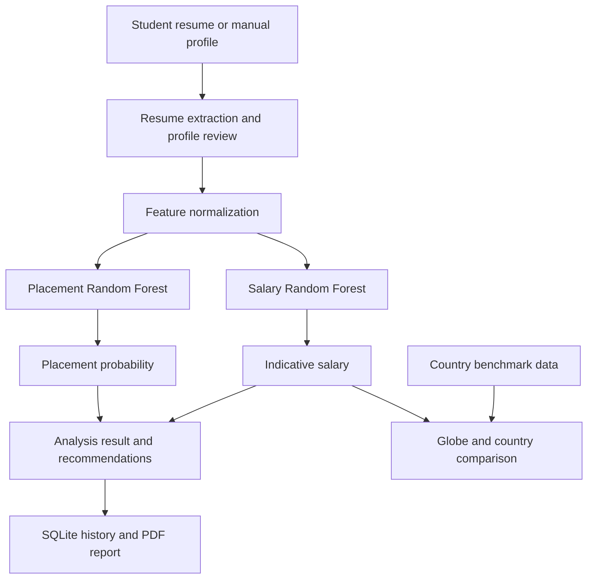

[README .md](https://github.com/user-attachments/files/34972792/README.2.md)
<div align="center">
  

  # Placement Intelligence

  **A local-first placement analytics and career-readiness workspace for students.**

  Turn a resume or student profile into an explainable placement estimate, an indicative salary estimate, an ATS keyword review, and an interactive international career comparison.

  
  
  
  
  

  [Features](#-features) · [Quick start](#-quick-start) · [How it works](#-how-it-works) · [API](#-api-reference) · [Deployment](#-deployment) · [Testing](#-testing)
</div>

---

## 📌 Overview

Placement Intelligence is a student-focused application built around two scikit-learn models: a **Random Forest classifier** for placement probability and a **Random Forest regressor** for an indicative salary estimate. It wraps those models in a FastAPI application and a browser-based dashboard.

The project also includes resume parsing, a reviewable student profile, ATS-style keyword matching, saved analysis history, PDF reports, editable training datasets, and an interactive globe that compares indicative entry-level salary and cost benchmarks across countries.

> **Important:** This is an educational decision-support project, not a recruitment system. A model probability is not a guaranteed chance of placement, and salary or country benchmarks are indicative estimates. Read [Understanding the estimates](#-understanding-the-estimates) before relying on results.

## ✨ Features

| Area | Capabilities |
|---|---|
| **Placement prediction** | Random Forest placement classification and probability output |
| **Salary estimate** | Indicative salary regression trained on placed-student records |
| **Resume workflow** | Upload a resume, extract fields, review and edit the profile, then analyze |
| **Manual profile** | Enter student details without uploading a resume |
| **ATS keyword review** | Compare resume text with role-specific keyword lists |
| **Resume readiness** | Rules-based readiness score and suggestions |
| **Career globe** | Explore country-level salary, cost, tax, visa and skill information |
| **What-if tools** | Adjust profile assumptions and compare country fit |
| **History** | Save and search analyses; export history as CSV or JSON |
| **Reports** | Generate downloadable PDF reports and PNG result cards |
| **File library** | Store and manage uploaded files locally |
| **Dataset management** | Replace placement or salary datasets, validate them and retrain models |
| **Interface** | Responsive dashboard, animated visual design, dark/light themes and reduced-motion support |

## 🖥️ Application sections

### 1. Overview

A dashboard for saved-analysis counts, recent results, probability trends and the model's held-out evaluation metrics. It also links to external student and education resources; those listings are not used as model training data.

### 2. Work with a profile

Upload a supported resume, review extracted fields such as CGPA, projects, internships and skills, then run the prediction workflow. Alternatively, enter the profile manually. The ATS check compares resume keywords with the selected role's keyword list.

Supported input types include PDF, DOCX, TXT, Markdown, RTF, common image formats, CSV, Excel, JSON and HTML. Image OCR may require a system installation of [Tesseract OCR](https://github.com/tesseract-ocr/tesseract).

**Review extracted information before running a prediction.** Resume extraction is best-effort; it can misread values or leave fields blank.

### 3. Globe · Base price

Explore a 3D globe and select a country to view indicative entry-level salary ranges, estimated monthly living costs, tax assumptions, visa-route notes, in-demand skills and watch-outs. The view also includes a what-if simulator, weighted best-fit ranking, country comparison and export options.

The globe's figures are not live job listings or guaranteed offers. Country benchmarks and visa rules require independent verification against official sources.

### 4. History

Review previous analyses, search records, open individual results, download PDF reports, export CSV/JSON, or clear saved history.

### 5. Settings

Manage the workspace display name, theme, upload-size limit, original-file retention, datasets, local file library and saved records.

## 🚀 Quick start

### Requirements

- Windows, macOS or Linux
- **Python 3.12** recommended
- Git (optional, for cloning the repository)

### Windows — PowerShell

From the repository root (the folder containing `requirements.txt`):

```powershell
py -3.12 -m venv .venv
.\.venv\Scripts\Activate.ps1
python -m pip install --upgrade pip
python -m pip install -r requirements.txt
python -m uvicorn app.main:app --host 127.0.0.1 --port 8000
```

Open **http://127.0.0.1:8000** in your browser. Keep the terminal open while using the application; press `Ctrl+C` to stop the server.

### Windows — startup script

You can also run the included startup script:

```powershell
Set-ExecutionPolicy -Scope Process -ExecutionPolicy Bypass
.\start.ps1
```

Or double-click `start.bat` from File Explorer.

### macOS / Linux

```bash
python3.12 -m venv .venv
source .venv/bin/activate
python -m pip install --upgrade pip
python -m pip install -r requirements.txt
python -m uvicorn app.main:app --host 127.0.0.1 --port 8000
```

The first application startup initializes the SQLite database and trains both models from the included CSV datasets. Model initialization can take some time on the first run.

## 🧠 How it works



### Model training

- The placement classifier is trained using the placement dataset and predicts the `Placed` class probability.
- The salary regressor is trained using records marked as placed with a salary greater than zero.
- The application reports evaluation metrics from a held-out split of the included local data.
- The world-globe estimate maps a student's predicted-salary percentile against the model's out-of-bag salary predictions to country benchmark ranges. It is not a separate salary model trained on every country.

## 🗂️ Dataset schema

Both training datasets require the following feature columns:

| Feature | Feature | Feature |
|---|---|---|
| `CGPA` | `Major Projects` | `Mini Projects` |
| `Skills` | `Communication Skill Rating` | `Internship` |
| `Hackathon` | `12th Percentage` | `10th Percentage` |
| `backlogs` | `Workshops/Certificatios`* | |

\* The source dataset spelling `Workshops/Certificatios` is accepted. `Workshops/Certifications` is accepted too.

Additional target columns:

| Dataset | Required target columns | Training rule |
|---|---|---|
| Placement | `PlacementStatus` | Must contain placed and not-placed examples |
| Salary | `PlacementStatus`, `salary` | Uses placed rows with `salary > 0` |

Use the exact feature meanings and units expected by the original datasets when replacing them. A successful schema check does not guarantee that a new dataset is representative or suitable for real-world decisions.

## 📊 Understanding the estimates

- **Placement probability:** the classifier's estimated probability for the `Placed` class. The output is not necessarily calibrated and is not a guaranteed real-world placement chance.
- **Model metrics:** accuracy, precision, recall and F1 are calculated on a held-out split of the local training dataset. They are not independent college-wide or future-cohort validation results.
- **Salary estimate:** an indicative model output trained on placed-student rows only. It is not a salary offer or a guaranteed compensation figure.
- **Resume readiness score:** a transparent rules-based checklist, not an employer's ATS score.
- **Resume extraction:** best-effort. Verify CGPA, percentages, project counts, skills and experience flags before analyzing.
- **Country benchmarks:** salary, tax, living-cost and visa information are indicative. Some visa notes are marked as checked in the application, while other entries remain unverified. Always consult the relevant official government source before making a decision.
- **External services:** exchange-rate refresh and map-boundary data may require an internet connection. The app can fall back to locally bundled values or continue with reduced globe detail when external data is unavailable.

## 🧱 Project structure

```text
Placement-Intelligence/
├── app/
│   ├── main.py                 # FastAPI routes, history, uploads and reports
│   ├── engine.py               # Data validation, model training and resume/ATS logic
│   ├── world.py                # Country benchmarks, currency conversion and globe estimates
│   └── static/
│       ├── index.html          # Browser application
│       ├── app.js              # Main frontend behavior
│       ├── globe.js            # Globe visualization
│       ├── styles.css          # Main UI styles
│       ├── aurora.css          # Visual effects and themes
│       ├── fx.js               # Frontend effects
│       ├── extras.js           # Additional UI behavior
│       ├── img/                # SVG illustrations
│       └── vendor/             # Bundled third-party browser library
├── data/
│   ├── datasets/               # Placement and salary training CSVs
│   ├── uploads/                # Local uploaded-file storage
│   └── reports/                # Generated PDF reports
├── legacy/
│   └── original_colab_app.py   # Preserved original Colab/Gradio prototype
├── samples/
│   └── sample_resume.txt       # Sample input for local testing
├── tests/
│   └── test_core.py            # Core model and estimate tests
├── .gitignore
├── requirements.txt
├── start.bat
├── start.ps1
└── README.md
```

### Local storage

| Data | Location |
|---|---|
| SQLite analysis history and settings | `data/placement_history.sqlite3` |
| Uploaded files | `data/uploads/` |
| Generated reports | `data/reports/` |
| Training datasets | `data/datasets/` |

The SQLite database, uploads and reports are local application files. Back them up before deleting the project directory or changing environments.

## 🔌 API reference

The FastAPI application exposes the following main routes:

| Method | Endpoint | Purpose |
|---|---|---|
| `GET` | `/` | Serve the frontend |
| `GET` | `/api/bootstrap` | Initial dashboard data and settings |
| `GET` / `PUT` | `/api/settings` | Read or update workspace settings |
| `GET` | `/api/history` | List and search analysis history |
| `GET` | `/api/history/{record_id}` | Retrieve an analysis record |
| `DELETE` | `/api/history/{record_id}` | Delete one analysis record |
| `DELETE` | `/api/history` | Clear analysis history |
| `GET` | `/api/export/history` | Export history as CSV or JSON |
| `POST` | `/api/upload` | Add a file to the local library |
| `POST` | `/api/parse-resume` | Extract text and fields from a resume |
| `POST` | `/api/analyze` | Analyze a student profile |
| `GET` | `/api/reports/{record_id}` | Download a PDF report |
| `GET` / `DELETE` | `/api/files` and `/api/files/{file_id}` | List or delete library files |
| `GET` | `/api/files/{file_id}/download` | Download a stored file |
| `POST` | `/api/datasets/{kind}` | Replace a placement or salary dataset and retrain |
| `GET` | `/api/cohort` | Retrieve cohort summary data |
| `GET` | `/api/model` | Retrieve model details and metrics |
| `GET` | `/api/countries` | Retrieve country benchmark data |
| `POST` | `/api/world/estimate` | Estimate country-level salary benchmarks |
| `POST` | `/api/ats` | Run an ATS keyword check |
| `GET` | `/api/ats/roles` | List supported ATS role profiles |

Interactive API documentation is available at **`/docs`** while the local server is running.

## 🧪 Testing

Install pytest and run the test suite from the repository root:

```powershell
python -m pip install pytest
python -m pytest -q
```

Tests are located in `tests/test_core.py`. The README does not claim a passing test result; run the command in your own environment to verify the current checkout.

## ☁️ Deployment

### Render — Docker is not required

Render supports a native Python runtime, so this FastAPI project does **not** need a Dockerfile to run. For a basic Render Web Service, the configuration would use:

| Render setting | Value |
|---|---|
| Runtime | Python |
| Root directory | Leave blank when the repository root contains `app/` and `requirements.txt` |
| Build command | `pip install -r requirements.txt` |
| Start command | `uvicorn app.main:app --host 0.0.0.0 --port $PORT` |

See the official [Render Web Services guide](https://render.com/docs/web-services) and [Native Runtimes guide](https://render.com/docs/native-runtimes).

> **Deployment status: not ready for unrestricted public use.** This project was designed as a single-user local workspace. It currently has no real authentication or authorization, and several API routes can change or delete data, upload files, or replace training datasets. Do not publish it as a public web service until these operations are protected and the application has been reviewed for production security.

### Persistent data requirement

Render services use an ephemeral filesystem by default. Files written by the running application can be lost during restarts, redeploys or spin-downs. This matters because the current app stores SQLite history, uploads and PDF reports under its local `data/` directory.

Before relying on a hosted instance, make the data directory configurable, seed the included training CSVs into the configured data location when needed, and attach an appropriate persistent disk or move durable records/files to managed storage. Render documents persistent disks as a paid-service feature; its free web services do not support them. See [Render Persistent Disks](https://render.com/docs/disks) and [Render Free Instance Limitations](https://render.com/docs/free).

For a short-lived public demonstration, treat all runtime data as disposable and protect or disable write-capable endpoints. Do not upload real student resumes or personal information to an unauthenticated demo.

### Docker

There is no Dockerfile or Docker Compose configuration in this repository. That is intentional for local use and does not prevent a native Python deployment. Add Docker only if you need a reproducible container image, extra operating-system packages, or a container-based deployment workflow.

## 🔐 Privacy and security

- This application is currently a **single-user local workspace**, not a multi-user hosted platform.
- The welcome-screen display name is not password authentication.
- By default, the local server binds to `127.0.0.1`, making it available on the local machine only.
- Do not expose the app directly to the public internet without authentication, authorization, HTTPS, upload restrictions, secure storage and a security review.
- Treat resumes, uploaded documents and analysis history as sensitive personal data. Use synthetic/sample data for demonstrations.

## 🗺️ Data sources and limitations

The project includes local training CSVs and a country benchmark table. It does not ingest live job vacancies, employer hiring decisions, AICTE listings or NIRF ranking data into the prediction model. Exchange rates are refreshed on a best-effort basis through an external service and use a bundled fallback when that service is unavailable. Country pay and living-cost figures remain indicative; verify them independently.

## 🛣️ Possible next steps

- Add authentication and role-based authorization before public hosting.
- Make the storage root configurable and introduce durable hosted storage.
- Add independent, time-based and institution-level model validation.
- Calibrate classifier probabilities and document model limitations.
- Add dataset provenance, licensing and update dates.
- Add a deployment health check and automated CI test workflow.
- Add a documented Docker option only if container deployment is needed.

## 📜 Original prototype

The original Google Colab/Gradio application is preserved in `legacy/original_colab_app.py`. The sample resume in `samples/` is intended for local testing only.
